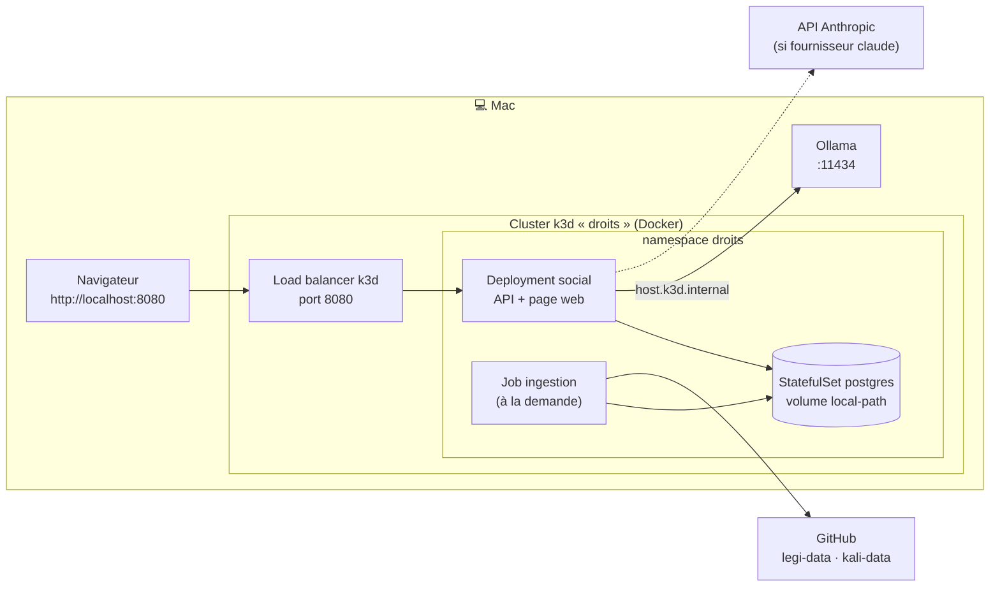

# Déploiement local (k3d)

L'application tourne comme elle tournerait en production : image construite par les buildpacks,
Postgres et application dans un vrai cluster Kubernetes ([k3d](https://k3d.io), k3s dans Docker),
ingestion en Job. Les manifestes de `deploy/k8s` serviront de base à la mise en ligne.



## Prérequis

Docker Desktop (8 à 10 Go de mémoire conseillés), `k3d`, `kubectl` ; `k9s` pour piloter le cluster.
Sur le Mac du projet : `sudo port install k3d k9s`.

## Commandes

```bash
deploy/local.sh cree     # cluster, image, Secrets, Postgres et application (quelques minutes la 1re fois)
deploy/local.sh ingere   # ingestion des sources dans la base du cluster (≈ 1 min), journaux suivis
deploy/local.sh image    # après une modification du code : nouvelle image, redémarrage de l'appli
deploy/local.sh etat     # ressources du namespace
deploy/local.sh detruit  # supprime le cluster et ses données
k9s -n droits            # pilotage : pods, journaux, événements
```

L'application est sur http://localhost:8080/ (page web) et http://localhost:8080/api ; Grafana sur
http://localhost:3000/ (lecture seule sans compte, `admin`/`admin` pour modifier).

## Choix

| Sujet | Choix | Pourquoi |
|---|---|---|
| Image | `./mvnw spring-boot:build-image` (buildpacks Paketo), importée par `k3d image import` | pas de Dockerfile à maintenir, pas de registre |
| Publication | Service `LoadBalancer` relié au port 8080 du Mac ; Traefik désactivé | pas de délai de proxy (≈ 60 s) qui couperait une rédaction lente d'Ollama ; moins de mémoire |
| Base | StatefulSet `pgvector/pgvector:0.8.7-pg18` (PostgreSQL 18 et pgvector), volume `local-path` de 2 Go | version épinglée ; données conservées tant que le cluster existe |
| Schéma | Liquibase au démarrage de l'application | comme hors cluster |
| Ingestion | Job lancé à la demande, hors de la kustomisation | une ingestion est une action, pas un état ; les sources restent épinglées dans `application.yaml` |
| Fournisseur | `ollama` par défaut (ConfigMap), Ollama sur le Mac via `host.k3d.internal` | gratuit, la question et le profil ne quittent pas la machine |
| Secrets | mot de passe Postgres tiré au hasard ; Secret `anthropic` créé seulement si `ANTHROPIC_API_KEY` est définie | rien de sensible dans le dépôt |
| Ordre de démarrage | conteneur d'attente `pg_isready` avant l'appli et l'ingestion | au premier démarrage, Postgres initialise sa base : sans attente, Liquibase échoue et le pod redémarre |
| Sondes | `/actuator/health/liveness` et `/readiness` (activées par Spring Boot sous Kubernetes), sonde de démarrage de 3 min | Liquibase et le démarrage peuvent être lents sur le Mac |
| Mémoire | appli 1 Gi, ingestion 1,5 Gi, Postgres 512 Mi, observabilité 2 Gi au plus ; `BPL_JVM_THREAD_COUNT=50` | tenir sur 16 Go avec Ollama ; le calculateur des buildpacks réserve sinon 250 threads |

Pour passer à Claude : `kubectl -n droits patch configmap social -p '{"data":{"DROITS_ASSISTANT_FOURNISSEUR":"claude"}}'`
puis `kubectl -n droits rollout restart deployment/social` (clé chargée par `deploy/local.sh cree`,
appels payants).

## Observabilité

Le Deployment `observabilite` (`grafana/otel-lgtm:0.41.1`, collecteur OpenTelemetry, Prometheus,
Tempo, Loki et Grafana dans un seul conteneur) reçoit les traces et métriques de l'application en OTLP
(`OTEL_COLLECTEUR=http://observabilite:4318`, profil `observabilite` dans la ConfigMap). Données en
mémoire, perdues au redémarrage du pod : c'est un outil de poste, pas un stockage.

- **Tableau de bord** « Droits des salariés : questions » (page d'accueil de Grafana) : dépense du jour,
  questions et coût par question sur 24 h, citations non vérifiées, issues des questions, 95e centile
  de la durée de chaque étape, coût et jetons par étape, appels au modèle par issue, garde-fous,
  chiffres non retrouvés et calculs, versions des consignes en service.
- **Traces** : Explore > Tempo, service `social` ; une trace par question, un span par étape
  (attributs dans [`fonctionnement.md`](fonctionnement.md#observabilité)).
- **Alertes** (dossier « Droits des salariés ») : dépense du jour au-delà de 8 $ (80 % du budget par
  défaut), plus de 2 appels au modèle en erreur en 15 min, une citation non vérifiée dans l'heure,
  95e centile de la rédaction au-delà de 2 min pendant 10 min. Sans point de contact configuré, elles
  s'affichent dans Grafana (Alerting) sans notifier.
- Fichiers : `deploy/k8s/observabilite/` (tableau de bord, fournisseur, alertes), montés par la
  ConfigMap générée par Kustomize. Noms dans Prometheus : points remplacés par des tirets bas,
  `_total` pour les compteurs, unité en suffixe (`droits_questions_etape_milliseconds_bucket`).
- Port 3000 : ajouté à `deploy/k3d/cluster.yaml` ; un cluster créé avant doit être recréé
  (`detruit` puis `cree`), ou passer par `kubectl -n droits port-forward svc/observabilite 3000`.

## Contrôles

- Le CI valide les manifestes contre les schémas de l'API Kubernetes (`kubeconform`, job « Manifestes Kubernetes »), sans cluster.
- Le profil n'est jamais journalisé : `kubectl -n droits logs deploy/social` ne montre que des comptes de jetons et des noms d'exceptions.
- Lancer l'ingestion une fois l'appli démarrée : les deux appliquent les changesets Liquibase, et le verrou de Liquibase fait attendre le second.
- Manifestes pensés pour un poste local : pas de `securityContext` (utilisateur non root, système de fichiers en lecture seule), à ajouter avant de les réutiliser pour la mise en ligne.
- Mémoire : arrêter le cluster (`k3d cluster stop droits`) pendant un `./mvnw verify`, qui démarre ses propres conteneurs.

## Suite

Diagnostic des pannes par k8sgpt (avec Ollama) et plugins k9s : PR suivante.
