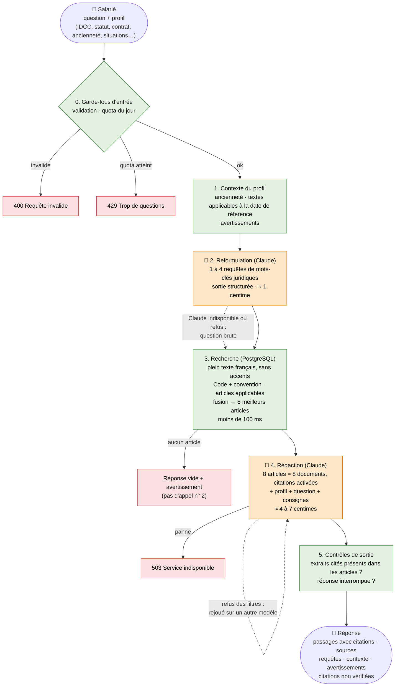
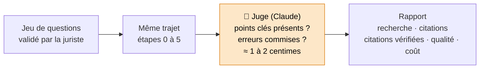

# Le trajet d'une question

Ce que fait l'application quand un salarié pose une question : deux appels à Claude seulement, tout
le reste est du code et de la base de données (gratuit et prévisible). Claude peut être remplacé par
un modèle local (voir [Fournisseur local : Ollama](#fournisseur-local--ollama)).

Légende : orange = appel payant à Claude, vert = code et base de données (gratuit), rouge = sortie en erreur.

La page web (`/`, fichiers statiques sans framework) envoie la question et le profil à
`POST /api/questions` (sans date de référence : la situation est évaluée à la date du jour), puis
affiche la réponse avec ses citations : un clic sur une citation ouvre le texte de l'article
(`GET /api/articles/{id}`). Le profil n'est gardé sur l'appareil que si la personne coche « Se
souvenir de mes informations », et un bouton l'efface.

## Les étapes

| Étape | Rôle | Coût |
|---|---|---|
| 0. Garde-fous d'entrée | Validation de la question (≤ 1000 caractères) et du profil, quota journalier global (200 par défaut). Ni la question ni le profil ne sont stockés ou journalisés (données sensibles : grossesse, santé). | gratuit |
| 1. Contexte du profil | Ancienneté à la date de référence (aujourd'hui par défaut), textes applicables à cette date (Code du travail, convention collective si intégrée), avertissements (convention non renseignée ou non intégrée). | gratuit |
| 2. Reformulation | Claude transforme la question en 1 à 4 requêtes de mots-clés juridiques, tels qu'ils apparaissent dans les textes. S'il est indisponible ou refuse, la recherche se fait sur la question brute. | ≈ 1 centime |
| 3. Recherche | Recherche plein texte dans le Code et la convention, limitée aux articles applicables à la date de référence ; fusion des résultats et sélection des 8 meilleurs. | gratuit |
| 4. Rédaction | Claude reçoit les 8 articles comme documents, avec les citations activées, et rédige en suivant ses consignes : s'en tenir aux articles, appliquer la disposition la plus favorable au salarié en le disant, donner les chiffres et les conditions, rappeler qu'il s'agit d'une information générale. | ≈ 4 à 7 centimes |
| 5. Contrôles de sortie | Vérification que chaque extrait cité existe dans l'article cité ; signalement d'une réponse interrompue. | gratuit |

## Fournisseur local : Ollama

Avec `droits.assistant.fournisseur=ollama`, les étapes 2 et 4 sont confiées à un modèle servi par
Ollama (Spring AI ; `qwen2.5:7b` par défaut, `spring.ai.ollama.chat.model` et
`spring.ai.ollama.base-url` pour en changer). Le trajet, les garde-fous et la réponse sont les mêmes ;
ce qui change :

| | Claude | Ollama |
|---|---|---|
| Coût | ≈ 5 à 8 centimes par question | gratuit (calcul de la machine) |
| Données | question et profil envoyés à Anthropic | restent sur la machine qui héberge le modèle |
| Durée | quelques secondes à une minute | une à plusieurs minutes sur un processeur sans carte graphique (délai de lecture : 10 min) |
| Citations | natives (l'API rattache chaque extrait au document) | demandées en JSON imposé par un schéma : numéro du document et extrait recopié ; un numéro inexistant est écarté |
| Contrôle des citations (étape 5) | protège d'une régression | indispensable : un petit modèle peut paraphraser au lieu de recopier |
| Refus, repli | refus signalé, repli côté serveur | pas de refus ; pas de repli |
| Rédaction illisible (hors du JSON demandé) | sans objet | 503, sauf si coupée par la limite de jetons (`num-predict`) : réponse vide signalée tronquée |
| Reformulation en panne ou illisible | question brute | question brute |

Ollama est relancé une fois sur erreur temporaire (`spring.ai.retry.max-attempts`, dix par défaut
dans Spring AI). Le contexte est porté à 16 384 jetons (`num-ctx`), car celui d'Ollama par défaut ne
contient pas huit articles.

## Ce qu'il faut retenir

- **Claude ne cherche pas lui-même et ne répond pas de mémoire** : il ne voit que les articles choisis à l'étape 3, et chaque affirmation pointe vers le passage précis de l'article qui la fonde.
- **La qualité dépend d'abord de la recherche** : si le bon article n'est pas parmi les 8, Claude ne peut pas le citer. C'est pourquoi l'évaluation mesure séparément la recherche et les citations.
- **Les incidents sont visibles** : refus, panne, réponse interrompue, citation introuvable ou absence d'article donnent un statut ou un avertissement explicite, jamais une réponse présentée comme complète.

## Observabilité

Chaque question alimente des métriques (Micrometer), **sans donnée personnelle** (ni question, ni
profil). Seul `/actuator/health` est exposé par défaut ; `/actuator/info`, `/actuator/metrics` et
`/actuator/prometheus` s'ouvrent avec le profil `observabilite` :

| Métrique | Étiquettes | Ce qu'elle suit |
|---|---|---|
| `droits.questions` | issue : repondue, aucun_article, refus, tronquee, indisponible, invalide, erreur | issue de chaque question qui atteint le service (le quota et la validation du corps de requête refusent avant) |
| `droits.questions.etape` | etape : reformulation, recherche, redaction | durée de chaque étape |
| `droits.assistant.appels` | fournisseur : claude, ollama ; etape ; issue : succes, refus, tronquee, illisible (Ollama), erreur | appels au modèle |
| `droits.assistant.jetons` | fournisseur, etape, sens : entree, sortie | jetons consommés (le coût, pour Claude) |
| `droits.citations` | verification : verifiee, non_verifiee | résultat du contrôle de sortie |
| `droits.questions.quota_atteint` | | questions refusées par le quota |

Ils révèlent le volume, le coût et le quota : ne pas activer ce profil sur un serveur public sans
protection (port interne, authentification).

## L'évaluation

Le même trajet sert à mesurer la fiabilité des réponses, sur un jeu de questions dont la réponse a été
validée par une juriste (`src/test/resources/evaluation/questions.yaml`).

| Indicateur | Question posée |
|---|---|
| Recherche | Les articles attendus ont-ils été transmis à Claude ? |
| Citations | Claude a-t-il cité les articles attendus ? |
| Citations vérifiées | Les extraits cités existent-ils dans les articles ? |
| Qualité (juge) | Les points clés de la réponse de référence sont-ils présents, chiffres exacts compris ? |

Lancement : voir `CLAUDE.md` (section Tests). Avec `-Ddroits.assistant.fournisseur=ollama`, le
même jeu est posé au modèle local, le juge restant Claude : les deux rapports se comparent
directement (coût affiché nul pour le modèle local, durée par question). En mode lots (`-Devaluation.lots=true`), les appels
passent par l'API Batch d'Anthropic, à moitié prix : trois lots successifs (reformulations, puis
rédactions après la recherche locale, puis juge), traités en quelques minutes à quelques heures.

## Calculateur d'indemnité de licenciement

`POST /api/calculs/indemnite-licenciement` calcule l'indemnité **par le code**, sans appel au modèle
(gratuit) : légale et, si la convention est intégrée, conventionnelle ; le montant le plus élevé est
retenu, avec le détail des deux calculs, les articles sources et les hypothèses.

Règles, sources et questions en cours de validation juridique :
[`regles-indemnite-licenciement.md`](regles-indemnite-licenciement.md).

## Évolution prévue

Le calculateur sera branché sur le trajet des questions, entre la recherche et la rédaction : quand la
question porte sur l'indemnité de licenciement, le montant calculé sera transmis à Claude, qui
l'expliquera au lieu de le calculer. La suite est décrite dans
[`FEUILLE_DE_ROUTE.md`](../FEUILLE_DE_ROUTE.md).
