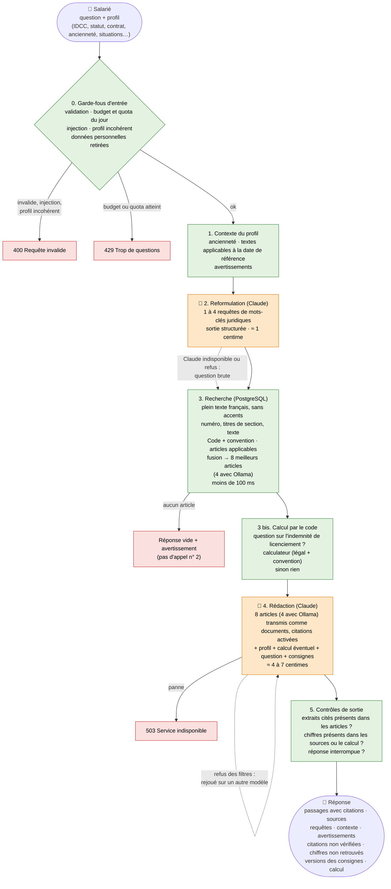
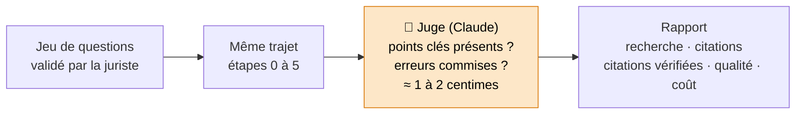
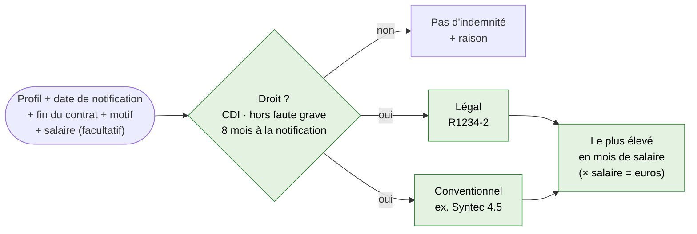

# Le trajet d'une question

Ce que fait l'application quand un salarié pose une question : deux appels à Claude seulement, tout
le reste est du code et de la base de données (gratuit et prévisible). Claude peut être remplacé par
un modèle local (voir [Fournisseur local : Ollama](#fournisseur-local--ollama)).

Légende : orange = appel payant à Claude, vert = code et base de données (gratuit), rouge = sortie en erreur.

La page web (`/`, fichiers statiques sans framework) envoie la question et le profil à
`POST /api/questions` (sans date de référence : la situation est évaluée à la date du jour), puis
affiche la réponse avec ses citations : un clic sur une citation ouvre le texte de l'article
(`GET /api/articles/{id}`). La réponse, écrite en Markdown par le modèle, est mise en forme par la
page (`markdown.js` : titres, gras, listes, tableaux), sans bibliothèque et sans jamais interpréter de
HTML venu du modèle ; les passages sont assemblés avant la mise en forme, les citations restant à
leur place. Le profil n'est gardé sur l'appareil que si la personne coche « Se
souvenir de mes informations », et un bouton l'efface.

Le salarié qui ne connaît pas sa convention collective peut chercher son entreprise par son nom, son
SIREN ou son SIRET : `GET /api/entreprises?q=` interroge l'annuaire public des entreprises (API
Recherche d'entreprises de l'État, gratuite, sans clé) et renvoie, pour au plus 5 entreprises, les
conventions de l'entreprise (recherche par nom ou SIREN) ou de l'établissement (SIRET), sans l'IDCC 9999
(« sans convention »), en disant si chacune est intégrée à l'application (`EntrepriseService`). Un clic
sur une convention la choisit dans le profil. Un SIRET que l'annuaire ne renvoie pas donne les
conventions de l'entreprise. Devant l'annuaire (environ 7 requêtes par seconde au plus, pour tous ses utilisateurs) : cache en
mémoire d'une heure (500 recherches), au plus 5 appels par seconde depuis l'application, 429 au-delà.
La recherche n'est ni stockée ni journalisée ; si l'annuaire ne répond
pas (délai de 10 s) ou répond de façon illisible, 503 et message dans la page. Pas de transaction
pendant l'appel : la base n'est sollicitée qu'une fois, pour les titres des conventions.

## Les étapes

| Étape | Rôle | Coût |
|---|---|---|
| 0. Garde-fous d'entrée | Validation de la question (≤ 1000 caractères) et du profil, quota journalier global (200 par défaut, `droits.questions.quota-journalier` ; anciennement `droits.claude.quota-journalier`) et budget journalier en dollars (10 $ par défaut, `droits.questions.budget-journalier-usd` : dépense du jour au prix de chaque appel, alerte dans le journal à 80 % et 100 %, voir [`couts-et-modeles.md`](couts-et-modeles.md)). Refus (400), avant tout appel payant, d'une tentative d'injection dans la question ou la classification (« ignore tes consignes », « révèle ton prompt système », balises de rôle : `InjectionConsignes`, formules adressées au modèle seulement, pour ne pas refuser « mon employeur ignore les consignes de sécurité ») et d'un profil incohérent (date d'entrée après la date de référence, ancienneté supérieure à l'âge moins 14 ans). Les données personnelles du texte libre (e-mail, numéro de sécurité sociale, téléphone, IBAN) sont remplacées par leur nature (« [téléphone] ») avant l'envoi au modèle, avec un avertissement (`DonneesPersonnelles`). Ni la question ni le profil ne sont stockés ou journalisés (données sensibles : grossesse, santé). | gratuit |
| 1. Contexte du profil | Ancienneté à la date de référence (aujourd'hui par défaut), textes applicables à cette date (Code du travail, convention collective si intégrée), avertissements (convention non renseignée ou non intégrée). | gratuit |
| 2. Reformulation | Claude (`droits.claude.modele-reformulation` s'il diffère du modèle de la rédaction, choisi par l'évaluation de la reformulation seule : [`couts-et-modeles.md`](couts-et-modeles.md)) transforme la question en 1 à 4 requêtes de mots-clés juridiques, tels qu'ils apparaissent dans les textes. S'il est indisponible ou refuse, la recherche se fait sur la question brute. Avec un modèle local, exemples et simplification des requêtes en plus (voir [Fournisseur local : Ollama](#fournisseur-local--ollama)). | ≈ 1 centime |
| 3. Recherche | Recherche plein texte dans le Code et la convention, limitée aux articles applicables à la date de référence. Chaque article est indexé par son numéro et les titres de ses sections (poids fort), puis son texte : les mots d'un article de principe sont souvent dans le titre de sa section (« Congés payés ») plutôt que dans son texte. Puis fusion des résultats et sélection des 8 meilleurs (4 pour un modèle local). La convention est aussi cherchée à part, et 2 places sur 8 (1 sur 4) vont d'abord à ses meilleurs articles, s'ils atteignent la moitié de la pertinence du dernier article qui aurait été retenu sans réserve ; sinon, les places reviennent au Code. Sans cette réserve, les sections du Code occupaient toutes les places et des articles décisifs de la convention (Syntec 4.5, indemnité de licenciement) n'étaient jamais transmis. Réglage choisi avec l'évaluation gratuite de la recherche : 26 → 28 articles attendus sur 48 (`PART_CONVENTION`, `PERTINENCE_MIN_CONVENTION`). Recherche sémantique en option (`droits.semantique.actif`, désactivée par défaut) : la question est comparée par le sens aux articles vectorisés (bge-m3 via Ollama, pgvector), et un article trouvé par le sens seulement prend la dernière place des articles trouvés par les mots (hors places de la convention), s'il est assez proche (similarité ≥ 0,5) ; modèle injoignable : les articles trouvés par les mots seuls, avec un avertissement au journal (sans la question). La question est envoyée au serveur Ollama configuré, local par défaut. Vectorisation au démarrage, sur demande (`droits.semantique.vectoriser=true`, après l'ingestion si elle est lancée en même temps), ou par l'évaluation de la recherche : seuls les articles applicables sans vecteur à jour sont traités, et le cache disque évite de les recalculer ; un article modifié garde son ancien vecteur jusqu'à la vectorisation suivante. Évaluation gratuite de la recherche : 28 → 32 articles attendus sur 48. | gratuit |
| 3 bis. Calcul | Une question qui nomme l'indemnité de licenciement, ou qui parle d'indemnité et de licenciement sans nommer une autre indemnité (journalières, de préavis, de congés payés, pour ou au titre du préavis ou des congés, de rupture conventionnelle… ; « une indemnité et un préavis » déclenche bien le calcul), sans tenir compte des accents ni des majuscules, déclenche le [calculateur d'indemnité](#calculateur-dindemnité-de-licenciement), sans appel au modèle (`CalculsQuestions`). Il calcule à la date de référence du profil, prise comme date de notification et de fin du contrat, en mois de salaire, ou en euros si la question donne un salaire mensuel brut (« je gagne 3 000 € brut » : montant présenté comme un salaire, ni prime ni indemnité ; annuel divisé par 12 ; net, plusieurs salaires ou montant hors de 300 à 50 000 € ignorés) ; le motif est lu dans la question (faute grave ou lourde, sauf niée : « sans faute grave », mais « sans préavis pour faute grave » reste une faute grave ; économique), personnel sinon. Ces choix, motif lu compris, rejoignent les hypothèses du résultat. Sans date d'entrée, le calcul est impossible et le modèle dit quoi préciser. Résultat dans le champ `calcul` de la réponse, affiché par la page web au-dessus de la réponse (`calcul.js` : montant retenu, puis détail, articles et hypothèses à déplier), avec un avertissement : règles en cours de validation juridique. Métrique `droits.questions.calculs` (issue : `fait`, `impossible`). | gratuit |
| 4. Rédaction | Claude reçoit les 8 articles (4 pour un modèle local) comme documents, avec les citations activées, et rédige en suivant ses consignes : s'en tenir aux articles, appliquer la disposition la plus favorable au salarié en le disant, donner les chiffres et les conditions, rappeler qu'il s'agit d'une information générale. Le calcul de l'étape 3 bis arrive en texte, entre le profil et la question (pas comme document : il ne se cite pas) ; la consigne demande d'en reprendre les chiffres tels quels et de les expliquer en citant les articles, jamais de les recalculer. | ≈ 4 à 7 centimes |
| 5. Contrôles de sortie | Vérification que chaque extrait cité existe dans l'article cité ; chiffres de la réponse (durées, montants, pourcentages) recherchés dans les articles transmis (nombres en lettres compris : « quatre-vingt-dix », « un quart »), le profil, la question et le calcul de l'étape 3 bis : un chiffre absent (souvent un calcul) est signalé « à vérifier », sans être retiré (`VerificationChiffres`, champ `chiffresNonRetrouves`) ; signalement d'une réponse interrompue. | gratuit |

**Consignes versionnées.** Les consignes des étapes 2 et 4 sont des fichiers :
`src/main/resources/prompts/reformulation.md` et `redaction.md`, complétés pour Ollama par
`ollama-exemples-reformulation.md` et `ollama-citations.md` ; celles du juge de l'évaluation sont dans
`src/test/resources/prompts/juge.md`. Leur version est l'empreinte (SHA-256, 8 caractères) du texte exact
envoyé au modèle : elle change d'elle-même à chaque retouche. Chaque réponse porte les versions de ses
deux étapes (`consignes` : `reformulation`, `redaction`), comme la métrique `droits.assistant.consignes`,
les rapports d'évaluation et `historique.csv`.

## Fournisseur local : Ollama

Avec `droits.assistant.fournisseur=ollama`, les étapes 2 et 4 sont confiées à un modèle servi par
Ollama (Spring AI ; `qwen2.5:7b` par défaut, `spring.ai.ollama.chat.model` et
`spring.ai.ollama.base-url` pour en changer). Le trajet, les garde-fous et la réponse sont les mêmes ;
ce qui change :

| | Claude | Ollama |
|---|---|---|
| Coût | ≈ 5 à 8 centimes par question (reformulation et rédaction) | gratuit (calcul de la machine) |
| Données | question et profil envoyés à Anthropic | restent sur la machine qui héberge le modèle |
| Durée | quelques secondes à une minute | plusieurs minutes sur un processeur sans carte graphique ; plafond de 10 min (délai de lecture de l'appli, et proxy de k3d en local) : une seule question à la fois |
| Articles transmis à la rédaction | 8 | 4 (`Assistant.articlesMax`) : la lecture des articles domine la durée ; avec 8 articles, un 7B sur processeur dépassait 10 min |
| Citations | natives (l'API rattache chaque extrait au document) | demandées en JSON imposé par un schéma : numéro du document et extrait recopié ; un numéro inexistant est écarté |
| Contrôle des citations (étape 5) | protège d'une régression | indispensable : un petit modèle peut paraphraser au lieu de recopier |
| Refus, repli | refus signalé, repli côté serveur | pas de refus ; pas de repli |
| Rédaction illisible (hors du JSON demandé) | sans objet | 503 |
| Rédaction coupée par la limite de jetons (`num-predict`) | passages reçus, signalés tronqués | JSON complet : passages servis, signalés tronqués ; JSON inachevé : illisible, donc **réponse vide** signalée tronquée (rien de ce qui a été généré n'est montré) |
| Reformulation | consignes seules | consignes plus trois exemples (thèmes hors du jeu d'évaluation), puis requêtes ramenées à trois mots-clés au plus, sans chiffres ni mots vides, sans IDCC, « convention collective » ni type de contrat recopiés du profil (gardés si la question les emploie : « fin de CDD ») : les petits modèles recopient le profil dans des requêtes trop longues, qui ne trouvent aucun article |
| Versions des consignes | empreintes de `reformulation.md` et `redaction.md` | empreintes des mêmes consignes suivies de leurs compléments (`ollama-exemples-reformulation.md`, `ollama-citations.md`) : versions distinctes de celles de Claude, puisque le texte envoyé diffère |
| Reformulation en panne ou illisible | question brute | question brute |

Ollama est relancé une fois sur erreur temporaire (`spring.ai.retry.max-attempts`, dix par défaut
dans Spring AI). Le contexte est porté à 12 288 jetons (`num-ctx`) et la réponse limitée à 3 072
(`num-predict`) : le contexte par défaut d'Ollama (2 048) ne contient pas quatre articles, et Ollama
tronque sans prévenir un texte trop long.

Premier essai réel (Mac Intel sans carte graphique, 16 Go) : Qwen 2.5 7B et Mistral 7B recopiaient le
profil dans des requêtes trop longues (« convention collective idcc 1486 cdi cadre essai durée »), qui
ne trouvaient aucun article ; d'où les exemples et la simplification des requêtes. Les deux modèles
chargés ensemble (12,8 Go) faisaient basculer le Mac en mémoire d'échange : n'en garder qu'un.

## Ce qu'il faut retenir

- **Claude ne cherche pas lui-même et ne répond pas de mémoire** : il ne voit que les articles choisis à l'étape 3, et chaque affirmation pointe vers le passage précis de l'article qui la fonde.
- **La qualité dépend d'abord de la recherche** : si le bon article n'est pas parmi les 8, Claude ne peut pas le citer. C'est pourquoi l'évaluation mesure séparément la recherche et les citations.
- **Les incidents sont visibles** : refus, panne, réponse interrompue, citation introuvable ou absence d'article donnent un statut ou un avertissement explicite, jamais une réponse présentée comme complète.

## Observabilité

Chaque question alimente des métriques (Micrometer), **sans donnée personnelle** (ni question, ni
profil). Seul `/actuator/health` est exposé par défaut ; `/actuator/info`, `/actuator/metrics` et
`/actuator/prometheus` s'ouvrent avec le profil `observabilite` :

| Métrique | Étiquettes | Ce qu'elle suit |
|---|---|---|
| `droits.questions` | issue : repondue, aucun_article, refus, tronquee, indisponible, invalide, erreur | issue de chaque question qui atteint le service (le quota et la validation du corps de requête refusent avant) |
| `droits.questions.etape` | etape : reformulation, recherche, redaction ; error : none ou l'exception | durée de chaque étape |
| `droits.assistant.appels` | fournisseur : claude, ollama ; etape ; issue : succes, refus, tronquee, illisible (Ollama), erreur | appels au modèle |
| `droits.assistant.jetons` | fournisseur, etape, sens : entree, sortie | jetons consommés (le coût, pour Claude) |
| `droits.citations` | verification : verifiee, non_verifiee | résultat du contrôle de sortie |
| `droits.questions.quota_atteint` | | questions refusées par le quota |
| `droits.assistant.cout_usd` | fournisseur, etape | coût des appels en dollars, au prix du modèle de chaque étape (`AssistantClaude.PRIX`, table de llmeval4j) |
| `droits.assistant.depense_jour_usd` | | dépense du jour (jauge), pour alerter |
| `droits.questions.budget_atteint` | | questions refusées par le budget journalier |
| `droits.questions.calculs` | issue : fait, impossible | calculs faits par le code pour une question (étape 3 bis) |
| `droits.garde_fous` | type : injection, donnees_personnelles (une par donnée retirée), profil_incoherent | interventions des garde-fous d'entrée |
| `droits.chiffres_non_retrouves` | | chiffres des réponses absents des sources |
| `droits.assistant.consignes` | modele, reformulation, redaction | jauge à 1 portant les versions des consignes en service, à croiser avec les autres métriques |

Ils révèlent le volume, le coût et le quota : ne pas activer ce profil sur un serveur public sans
protection (port interne, authentification).

**Traces et envoi OTLP.** Chaque étape du trajet (`MetriquesQuestions.chronometrer`) est une
observation Micrometer : elle donne la durée `droits.questions.etape` et un span OpenTelemetry, enfant
de la requête HTTP. Les spans portent des attributs utiles au diagnostic, jamais la question, le
profil ni la réponse :

| Étape | Attributs |
|---|---|
| reformulation | modele, consignes (version), requetes (nombre), fournisseur, jetons.entree, jetons.sortie, cout_usd |
| recherche | articles (nombre transmis), convention (IDCC fourni ou non) |
| redaction | modele, consignes, calcul (fait ou non), fournisseur, jetons, cout_usd |

Rien n'est envoyé par défaut (export OTLP des traces et des métriques désactivé). Avec le
profil `observabilite`, traces et métriques partent en OTLP
vers `OTEL_COLLECTEUR` (`http://localhost:4318` sinon), toutes les questions étant tracées
(échantillonnage à 100 %). Dans le cluster k3d, la pile Grafana LGTM les reçoit, avec un tableau de
bord et des alertes (voir [`deploiement-local.md`](deploiement-local.md#observabilité)).

## L'évaluation

Le même trajet sert à mesurer la fiabilité des réponses, sur un jeu de questions dont la réponse a été
validée par une juriste (`src/test/resources/evaluation/questions.yaml`).

| Indicateur | Question posée |
|---|---|
| Recherche | Les articles attendus ont-ils été transmis à Claude ? |
| Citations | Claude a-t-il cité les articles attendus ? |
| Citations vérifiées | Les extraits cités existent-ils dans les articles ? |
| Qualité (juge) | Les points clés de la réponse de référence sont-ils présents, chiffres exacts compris ? |

**Évaluation complète dans la CI** (workflow « Évaluation complète », payant) : sur l'étiquette `eval`
d'une PR, d'office à l'ouverture d'une PR qui touche les consignes, la recherche, le trajet des questions
ou `application.yaml` (les commits suivants ne relancent pas : reposer l'étiquette), et chaque lundi sur
`main`. Le résultat est comparé à la dernière ligne de l'historique faite avec le même modèle et le même
nombre de questions, commenté
dans la PR, et le job échoue sur une baisse nette de qualité, d'erreurs ou de citations vérifiées (la
recherche, qui varie avec la reformulation, y est indicative : elle est contrôlée sur requêtes figées). Authentification par fédération d'identité, sans clé
stockée : voir [`evaluation-ci.md`](evaluation-ci.md).

**Évaluation de la recherche, gratuite, dans chaque PR** (job CI « Évaluation de la recherche ») : les
requêtes de reformulation d'une évaluation complète sont figées (`src/test/resources/evaluation/requetes.yaml`)
et rejouées sur les vraies sources, sans appel au modèle ; elle mesure l'indicateur « recherche » (articles
attendus parmi les 8 retenus) et échoue s'il baisse par rapport à la référence versionnée
(`recherche-reference.json`), ou si une question perd un article qu'elle retrouvait : accepter un
compromis (des pertes compensées par des gains) passe par une réécriture de la référence, visible dans
le diff. Elle isole la recherche : un réglage du classement se mesure en deux minutes,
sans le bruit des reformulations, qui varient d'un passage à l'autre. Les requêtes figées gardent la
version des consignes de reformulation qui les a produites : si elle diffère de l'actuelle, le rapport les
signale périmées (sans échec : les régénérer demande une évaluation payante).

Résultats et conclusions de chaque évaluation, historisés : [`evaluations/`](evaluations/README.md)
(tableau de l'historique, analyses datées, rapports bruts, `historique.csv`).

Lancement : voir `CLAUDE.md` (section Tests). Avec `-Ddroits.assistant.fournisseur=ollama`, le
même jeu est posé au modèle local, le juge restant Claude : les deux rapports se comparent
directement (coût affiché nul pour le modèle local, durée par question). En mode lots (`-Devaluation.lots=true`), les appels
passent par l'API Batch d'Anthropic, à moitié prix : trois lots successifs (reformulations, puis
rédactions après la recherche locale, puis juge), traités en quelques minutes à quelques heures.

## Calculateur d'indemnité de licenciement

`POST /api/calculs/indemnite-licenciement` calcule l'indemnité **par le code**, sans appel au modèle
(gratuit) : légale et, si la convention est intégrée, conventionnelle ; le montant le plus élevé est
retenu, avec le détail des deux calculs, les articles sources et les hypothèses.

Règles, sources et questions en cours de validation juridique :
[`regles-indemnite-licenciement.md`](regles-indemnite-licenciement.md).

Le même calcul sert aux questions sur l'indemnité de licenciement (étape 3 bis) : Claude en reçoit le
résultat et l'explique au lieu de le calculer ; la page web l'affiche au-dessus de la réponse. La suite est décrite dans
[`FEUILLE_DE_ROUTE.md`](../FEUILLE_DE_ROUTE.md).
